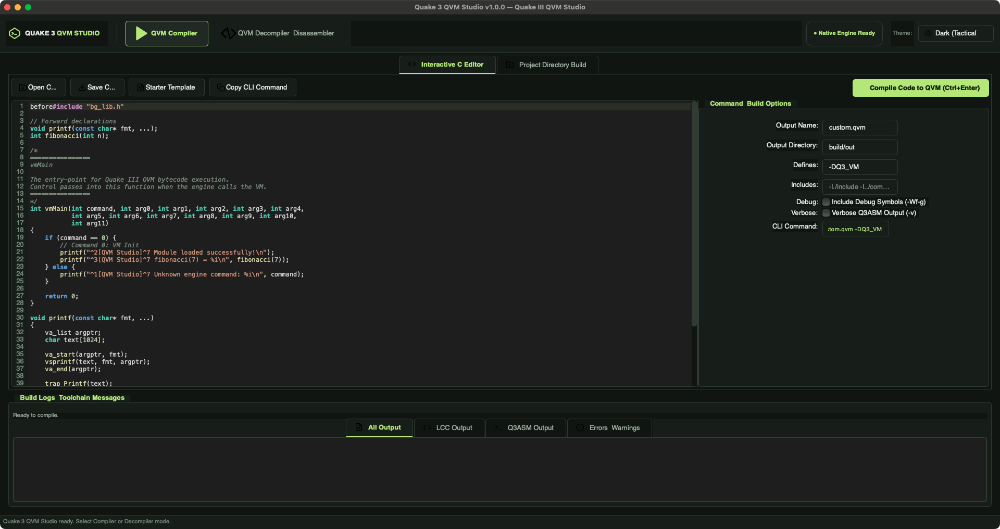
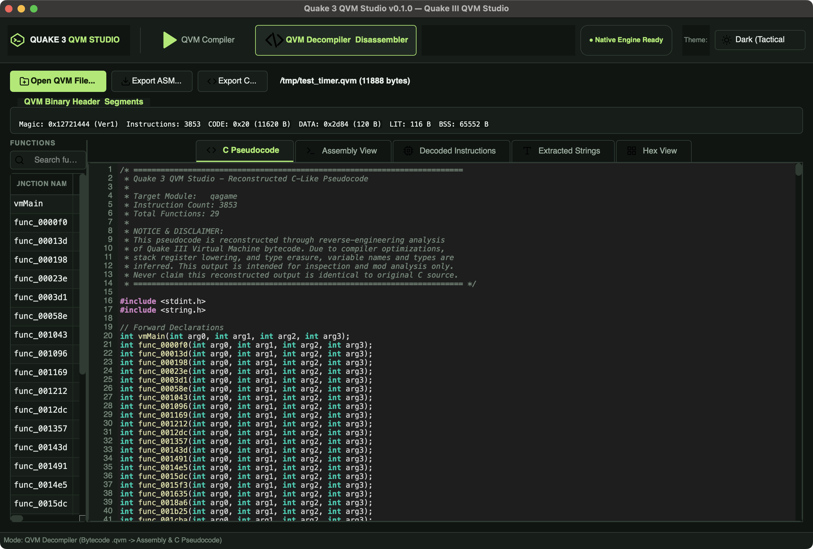

# Quake 3 QVM Editor

<div align="center">

[](LICENSE)
[](https://en.cppreference.com/w/cpp/20)
[](https://www.qt.io/)
[](https://github.com/id-Software/Quake-III-Arena)
[](https://github.com/heaven-hm/quake3-qvm-editor/releases)
[](tests/)

**A dedicated, modern, cross-platform Quake III Arena QVM compiler, editor, inspector, and decompiler.**  
*Engineered in modern C++20 and Qt 6 Widgets, with both a graphical desktop application (GUI) and a zero-dependency command-line interface (CLI).*

[Features](#key-features) •
[Screenshots](#screenshots) •
[Architecture](#architecture) •
[Building](#building-from-source) •
[CLI Reference](#command-line-interface-q3vm) •
[GUI Workflow](#gui-workflow) •
[Attribution & License](#attribution--license)

</div>

---

## Overview

**Quake 3 QVM Editor** unites the complete Quake III Arena virtual machine development and reverse-engineering lifecycle into a single polished application. It provides bidirectional workflows:

1. **C Source Code &rarr; Compile &rarr; QVM Bytecode**
   - Write or edit C code directly inside the built-in IDE editor with syntax highlighting and live CLI command preview.
   - Compile individual C files or entire mod source trees (`qagame`, `cgame`, `ui`, `custom`) using the official Quake III toolchain (**LCC** compiler and **Q3ASM** assembler).
   - Seamlessly auto-resolves official Quake III Arena game headers (`g_local.h`, `bg_lib.h`, `q_shared.h`, `bg_public.h`, `g_public.h`).

2. **QVM Bytecode &rarr; Disassemble / Decompile &rarr; Reconstructed C Pseudocode**
   - Inspect QVM binary headers, instruction stream, data sections, and string tables.
   - Decompile bytecode into structured, C-like pseudocode with control-flow reconstruction and stack-variable recovery.
   - **Single-Function Inspection**: Click any function to instantly isolate and inspect only that function's pseudocode, assembly instructions, and stack frame.
   - Export disassembly (`.asm`) and pseudocode (`.c`) with a single click.

---

## Screenshots

<div align="center">

### Interactive C Code Editor & Compiler
*In-editor C coding, real-time C syntax highlighting, starter templates, CLI command preview, build flags, and non-blocking background compilation.*



---

### QVM Bytecode Decompiler & Single-Function Inspector
*Single-function isolation mode, opcode table with operand decoding, reconstructed pseudocode, extracted strings, and raw hex inspector.*



</div>

---

## Key Features

- **Interactive C Editor**:
  - Full-featured code editor with C syntax highlighting (keywords, types, preprocessor directives, strings, comments, and `trap_*` engine syscalls).
  - Quick-start starter template generating a complete, compilable `vmMain` entry point.
  - Keyboard shortcuts (`Ctrl+Enter` / `Cmd+Enter` to compile on the fly).
  - Live CLI command generator reflecting output filenames, directories, `-I` include search paths, and `-D` preprocessor definitions.
  - Auto-resolves bundled official Quake III Arena SDK headers (`g_local.h`, `bg_lib.h`, `q_shared.h`).

- **Official Toolchain Integration**:
  - Compiles with the authentic Quake III Arena LCC compiler and Q3ASM assembler.
  - Multi-module target support: `qagame` (Server Game Logic), `cgame` (Client Game), `ui` (User Interface), and `custom` (Standalone Mods).
  - Configurable debug symbols (`-Wf-g`), verbose assembly logging (`-v`), and intermediate cleanup.

- **Bytecode Decompiler & Disassembler**:
  - Decodes all official 32-bit QVM opcodes (`OP_ENTER`, `OP_LEAVE`, `OP_CALL`, `OP_CONST`, `OP_JUMP`, `OP_EQ`, `OP_LOAD4`, `OP_STORE4`, `OP_ARG`, etc.).
  - Automatic function discovery, stack frame size calculation, entry/exit point detection, and bytecode hashing.
  - **Single-Function Focus Mode**: Select any function in the tree/table to instantly filter down the editor, assembly, and instruction views to just that selected subroutine.
  - Resolves standard Quake III engine trap syscalls by module context (`trap_Printf`, `trap_SnapVector`, `trap_Cvar_Set`, etc.).

- **Multiple Modern UI Themes**:
  - **Tactical Dark**: Sleek dark military theme with lime accent (`#b3e878`).
  - **Midnight Navy**: Deep dark navy theme (`#0d131e`) with electric cyan accent (`#7ecdf3`).
  - **Clean Light**: High-contrast daytime development theme.

- **Standalone C++20 CLI (`q3vm`)**:
  - Independent standard C++20 command-line utility with **zero Qt dependencies**.
  - Ideal for headless servers, automated CI/CD build scripts, and batch processing.

---

## Technology Stack

| Component | Technology | Description |
|---|---|---|
| **Programming Language** | C++20 | Modern ISO C++20 (`std::span`, `std::filesystem`, concepts) |
| **GUI Framework** | Qt 6 Widgets | Native high-performance desktop framework with Qt Svg |
| **CLI Tool** | Standard C++20 | Pure C++20 binary with zero GUI / Qt dependency |
| **Build System** | CMake 3.16+ | Modern CMake build configurations and multi-platform presets |
| **Compiler Toolchain** | Official Quake III LCC | Official Fraser & Hanson retargeted C bytecode compiler |
| **Assembler** | Official Quake III Q3ASM | Bytecode assembler and symbol linker |
| **Testing** | GoogleTest 1.14 | Comprehensive automated unit test suite (20/20 passing) |
| **Packaging** | CPack | Native packaging (macOS DMG/TGZ, Windows NSIS/ZIP, Linux DEB/RPM/TGZ) |

---

## Architecture

```text
quake3-qvm-editor/
├── CMakeLists.txt              # Root build script (Version 0.1.0)
├── CMakePresets.json           # Presets for Release, Debug, and CLI-only builds
├── LICENSE                     # GNU General Public License v2 (GPL-2.0)
├── README.md                   # Comprehensive project documentation
│
├── cmake/
│   ├── Dependencies.cmake      # Qt 6 and GoogleTest package discovery
│   ├── CompilerOptions.cmake   # Warning levels and MSVC/Clang flags
│   └── Packaging.cmake         # CPack multi-platform installer configuration
│
├── third_party/
│   └── quake3/                 # Authoritative id Software Quake III Arena source
│       ├── lcc/                # Original LCC C compiler (cpp, src, etc)
│       ├── q3asm/              # Original Q3ASM bytecode assembler
│       └── code/               # Original game modules (game, cgame, ui, q3_ui)
│
├── include/qvm/
│   ├── common/                 # Core utilities (Error, FileUtils, ProcessRunner, Version)
│   ├── format/                 # Binary layout (QvmHeader, QvmInstruction, QvmSections)
│   ├── compiler/               # Compilation engine (Compiler, ToolchainRunner, BuildPipeline)
│   └── decompiler/             # Decompiler engine (QvmParser, FunctionAnalyzer, PseudocodeGenerator)
│
├── source/
│   ├── common/                 # Common implementation files
│   ├── format/                 # QVM file binary readers and writers
│   ├── compiler/               # Pipeline execution and toolchain management
│   ├── decompiler/             # Flow-graph reconstruction, expression lowering, and export
│   ├── cli/main.cpp            # Standalone C++20 CLI tool (q3vm)
│   └── gui/                    # Qt 6 desktop application (q3vm_gui)
│
├── resources/
│   ├── icons/                  # Modern scalable vector graphics (SVG) icons
│   └── styles/                 # QSS stylesheets (dark.qss, midnight.qss, light.qss)
│
├── docs/screenshots/           # High-resolution application preview images
└── tests/                      # GoogleTest automated unit test suite
```

---

## Building from Source

### Prerequisites

- **CMake 3.16** or newer
- **C++20 compliant compiler**:
  - Windows: MSVC 2019 / 2022 (v142 or v143)
  - Linux: GCC 11+ or Clang 13+
  - macOS: Apple Clang 13+ / Xcode 13+
- **Qt 6.2+** with Widgets and Svg modules (required for GUI; optional for CLI-only builds)

### Standard Build (GUI + CLI + Tests)

```bash
# Clone the repository
git clone https://github.com/heaven-hm/quake3-qvm-editor.git
cd quake3-qvm-editor

# Configure build directory
cmake -S . -B build -DCMAKE_BUILD_TYPE=Release

# Compile all targets
cmake --build build --parallel

# Run test suite
ctest --test-dir build --output-on-failure
```

### Standalone CLI Only (Zero Qt Dependency)

```bash
cmake -S . -B build-cli -DQVM_BUILD_GUI=OFF -DCMAKE_BUILD_TYPE=Release
cmake --build build-cli --parallel
```

### Packaging Release Binaries (CPack)

```bash
cmake --build build --target package
# Generates DMG and .tar.gz on macOS, ZIP and NSIS installer on Windows, TGZ/DEB/RPM on Linux
```

---

## Command-Line Interface (`q3vm`)

The standalone command-line executable `q3vm` provides complete access to all compiler, assembler, disassembler, and decompilation capabilities without a desktop environment:

### Compiling Sources

```bash
# Compile single C file into QVM
q3vm compile g_main.c --output ./build --name custom.qvm

# Compile official mod source trees
q3vm compile --module qagame --source ./code/game --output ./build
q3vm compile --module cgame --source ./code/cgame --output ./build
q3vm compile --module ui --source ./code/q3_ui --output ./build

# Compile with custom preprocessor macros and include directories
q3vm compile --file ./source/mymod.c -DDEBUG -DQ3_VM -I./include --output ./build
```

### Inspecting and Disassembling QVM

```bash
# Display binary header, section offsets, and statistics
q3vm info ./build/qagame.qvm

# Disassemble bytecode into readable assembly
q3vm disassemble ./build/qagame.qvm --output ./build/qagame.asm

# Reconstruct C-like pseudocode
q3vm pseudocode ./build/qagame.qvm --output ./build/qagame.c

# Export both assembly and pseudocode simultaneously
q3vm export ./build/qagame.qvm --assembly ./build/qagame.asm --pseudocode ./build/qagame.c

# Full analysis and automated export
q3vm decompile ./build/qagame.qvm
```

---

## GUI Workflow

### 1. Interactive C Editor & Compiler Page
1. Navigate to the **Compiler** view.
2. In the **Interactive C Editor** tab, enter or paste your Quake III C code (or click **Starter Template**).
3. Adjust build flags in the **Command Options** panel (output name, output directory, preprocessor defines, include directories).
4. Click **Compile Code to QVM (Ctrl+Enter)** or press <kbd>Ctrl+Enter</kbd> (<kbd>Cmd+Enter</kbd> on macOS).
5. Watch the non-blocking build logs in the console panel.
6. Upon completion, click **Yes** to immediately load the newly compiled `.qvm` in the decompiler!

### 2. Decompiler & Inspector Page
1. Drag and drop any `.qvm` file into the window (or click **Open QVM...**).
2. Browse through detected subroutines in the **Functions** panel.
3. **Single Function Isolation**: Click any function in the table to display only that subroutine's pseudocode and instructions. Click **Show Full Module** to return to complete bytecode view.
4. Search functions or strings using real-time filter bars.
5. Export your findings via **Export Assembly (.asm)** or **Export Pseudocode (.c)**.

---

## Decompilation Notice & Disclaimer

Bytecode decompilation reconstructs program control flow and expressions through structural analysis of Quake III Virtual Machine stack operations. Because compiler optimizations and machine code lowering erase local variable names, struct layouts, typedefs, macro expansions, and comments, the generated C-like pseudocode is an **approximation** of the original source logic.

This reconstructed output is intended for mod inspection, debugging, and reverse engineering. It is distinctly marked and should never be represented as the exact original C source.

---

## Attribution & License

- **Quake 3 QVM Editor** is licensed under the [GNU General Public License Version 2 (GPL-2.0)](LICENSE).
- Portions Copyright &copy; 1999–2005 **Id Software, Inc.**
- Original official source code repository: [https://github.com/id-Software/Quake-III-Arena](https://github.com/id-Software/Quake-III-Arena)
- This project incorporates the original Quake III Arena virtual machine toolchain (`lcc`, `q3cpp`, `q3rcc`, `q3asm`), header definitions, and bytecode specifications originally authored by id Software.
- UI styling and workflow inspired by [project-igi-qvm-editor-web](https://github.com/heaven-hm/project-igi-qvm-editor-web).
- Reference C++20 architecture inspired by [project-igi-converter](https://github.com/heaven-hm/project-igi-converter).
